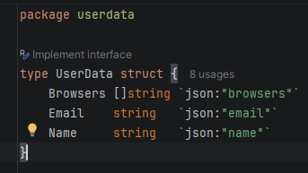
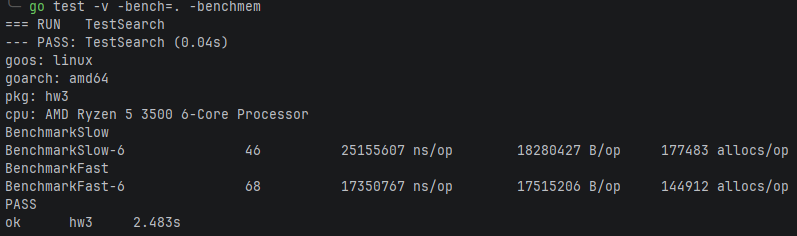
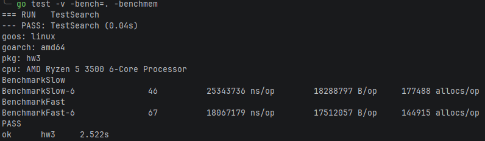
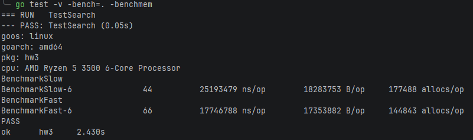

### Проблема №1 - Неэффективная десериализация данных

### Решение

Для ускорения десериализации я использовал библиотеку easyjson.
Сначала создал структуру только с самыми необходимыми полями из записи.



После с помощью команды ```easyjson -all userdata/userdata.go``` сгенерировал функции, необходимые для
десериализации данных из json в полученную структуру.


Результаты бенчмарка после первой оптимизации.



### Проблема №2 - Два прохода по списку юзеров

На самом деле достаточно всего одного, ведь тела обоих циклов идентичны.
Также можно использовать множества для хранения различных браузеров.

Однако результаты второй оптимизации оказались несколько плачевными.



### Проблема №3 - Конкатенация строк

Здесь лучше использовать стринг билдер.

Результаты бенчмаркинга незначительно улучшились.

